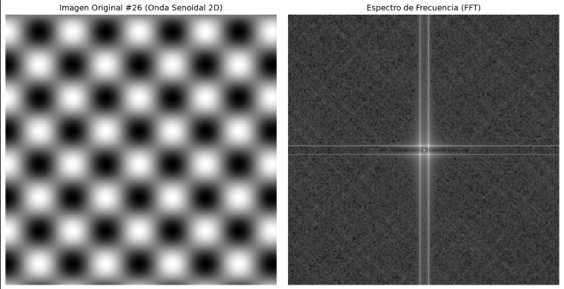
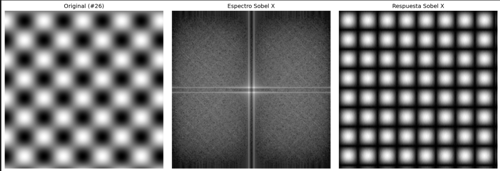
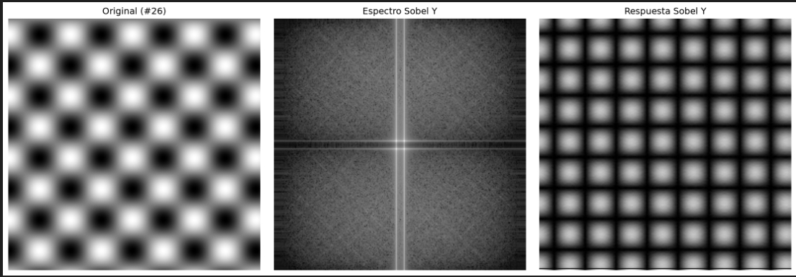
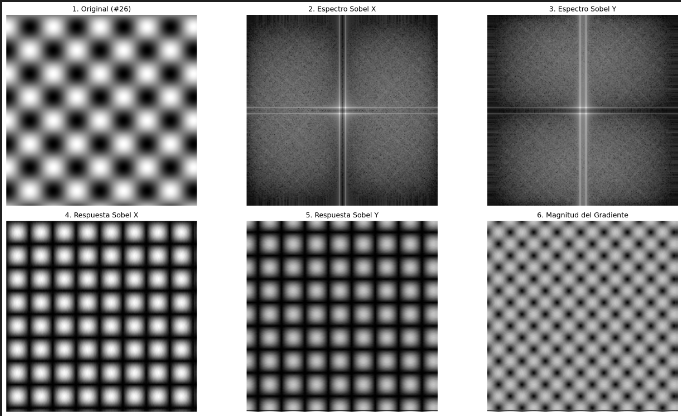

# UIII Act 7: Filtros Sobel en el dominio de la frecuencia
- **Alumno:** Axel Guzman
- **Número de Control (NC):** 0070
- **Asignatura:** Soluciona problemas de Visión Artificial
- **Especialidad:** Inteligencia Artificial (3er Semestre)
- **Número de lista:** 26 | **Imagen:** #26 Onda senoidal bidimensional

## 1. Estructura de carpetas y archivos
1. `codigopy-0070/` - Scripts de procesamiento en frecuencia
2. `resultados-img-0070/` - Gráficas generadas
3. `requirements.txt` - Librerías del entorno
4. `leeme-0070.md` - Documentación y resultados

## 2. Resultados e Imágenes
### 1. Imagen Original y Espectro de Frecuencia
La onda senoidal 2D de 256x256 píxeles concentra su energía en 4 picos simétricos cercanos al centro del espectro.

### 2. Filtro Sobel X
Detecta cambios horizontales de intensidad mediante la derivada parcial respecto a X.

### 3. Filtro Sobel Y
Detecta cambios verticales de intensidad mediante la derivada parcial respecto a Y.

### 4. Magnitud del Gradiente
Combina ambas respuestas direccionales mediante $G = \sqrt{G_x^2 + G_y^2}$.

## 3. Actividad de Reforzamiento
1. **Diferencia en el espectro respecto a una foto real:** Una foto real tiene frecuencias dispersas; la onda senoidal concentra su energía en 4 picos puntuales simétricos.
2. **Necesidad de `cv2.normalize`:** Las derivadas producen valores negativos y mayores a 255; normalizar escala los valores absolutos al rango `[0, 255]`.
3. **Diferencia entre $G_x + G_y$ y $\sqrt{G_x^2 + G_y^2}$:** La suma directa puede cancelar gradientes opuestos; la magnitud euclidiana preserva todos los cambios.